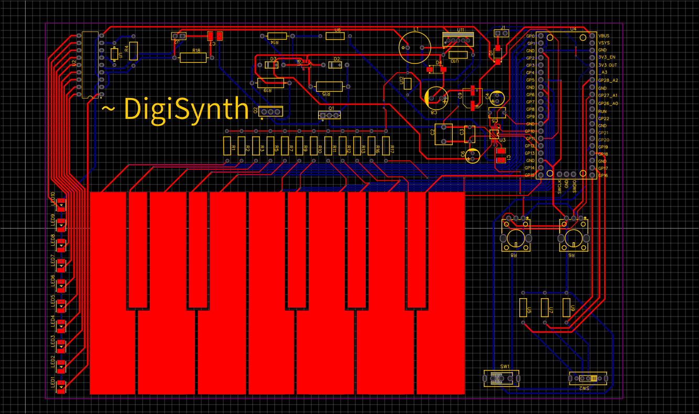
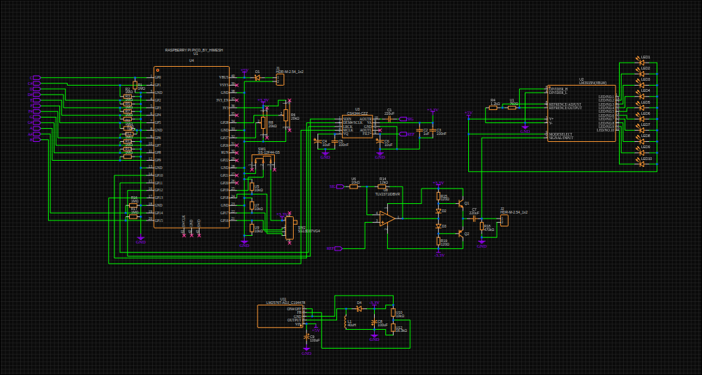

# DigiSynth
 

### What is it ?
This is a MIDI keyboard and synth that features its own analogue sound output
whith a volume level indicator and sound wave type controll

### Why does it exist ?

This is my spin on the starter project since creating a true AC signal from DC was always a fascination for me for years in the context of power inverters.

### How does it Work ?

When the board powers on, a pico 2 gets powered which reads the value of the Capacitive touch Keys, decides what what the DAC should output. Then communicates that with the DAC IC using the I2S Protocol this then creates a signal from 0 to 3.3V which gets amplified into an AC 3.3V signal which then gets buffered through a class AB amplifier th amplify the current that can be drawn from it the in gets output for use with a speaker or something else

A dedicated LED driver ic takes the signal and displays it as bar of leds depending on the volume 

The AC signal is only possible through a dual rail supply which is achieved using an inverting buck-boost converter

### How would I use it ?

Hopefully it should be Plug'n'play. Connection to usb is optional 
One switch decides if midi is enabled the other decides the wave form of the sound played and the potentiometers controll the volume and pitch

Also you obviously need to programm the pico 2 using PlatformIO with the firmware

